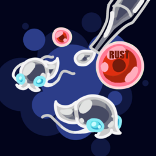

# RUSTibites



An open-source, readable, **high-speed** reimplementation of
[The Bibites](https://thebibites.com/) — the artificial-life evolution
simulator — written in Rust.

RUSTibites is reverse-engineered from the game's decompiled C# assembly and
validated against the retail game. It is built to run the same simulation
(brains, bodies, organs, ecology, evolution) **headless**, far faster than real
time, so that evolution experiments that take weeks in the original can run in
hours.

> **Parity caveat (2026-11-03).** A line-by-line audit of the decompiled game source against this code found that several parity
> claims in the status text below were overstated (simulation details, save/load, and especially the viewer UI). See
> [`docs/PARITY_AUDIT_SOURCE.md`](docs/PARITY_AUDIT_SOURCE.md) and [`docs/PARITY_AUDIT_UI.md`](docs/PARITY_AUDIT_UI.md) for the verified
> findings, the fixes made since, and the remaining gaps.

> **Status: `0.2.3` released (2026-11-03); `0.2.2` and earlier are historical.** The headless engine loads real
> saves/scenarios, simulates the full world tick, writes saves the original game
> loads, and passes the canonical **Default** parity baseline including the
> post-fix acquisition/feeding gap (§10.4.1: contacters 8/10 both, fed 8/8 both,
> consumed +5–6 % inside the single-pass band). Checkpoint/resume is **bit-exact
> on Default 120 / 1k / 2k / 5k / 10k** for 2× and 4× chunked runs, and the
> **100k** single vs 50×2,000 run now matches too (`8688404363908086484`; 10k
> `1750137736440958460`; fingerprints are tree-specific; dead-slot
> pellet/pheromone generation fix `8c799ec`).
> Renderer/HUD parity is measured at alpha-mask IoU **0.9890** overall, **0.9680**
> for the playback speed label (target met), **0.9154** ruler and **0.9920**
> expanded Stats; runtime Genes/Biology/Brain inspector tabs are **0.9887 /
> 0.9815 / 0.9877**. Remaining visual delta is speed-label thickness / TMP SDF
> raster quality (true SDF-atlas pass still future work).
> Historical 0.1.0 portable release: **`RUSTibites-0.1.0-windows-x64.zip`**, 36.71 MB
> (38,496,196 bytes), SHA-256 `b201c1b7…` (full hash in `docs/INSTALL.md`). Final Default throughput:
> **16,676 ticks/s (555.9× real time, serial)**; synthetic serial throughput is
> **1,483 / 715 / 220 / 94 / 41 ticks/s at 1k/2k/5k/10k/20k**, with 8-thread
> scaling: definitive thread A/B — **5k serial206.6/4t202.7 (0.981)/8t206.5 (1.00);
> 10k90.3/90.3 (1.00)/86.5 (0.958); 20k36.87/35.2 (0.955)/39.8 (1.08)**; explicit
> 4t/8t no longer regressed (within 4–5% noise), 8t helps 20k; fingerprints deterministic.
> Full matrix in `docs/BENCHMARKS.md`, and the 2,000-bibite dense cluster at **38.46 ms/tick**
> whole-tick. See `docs/ARCHITECTURE.md` §9–§10 and `docs/PARITY_ROUND2.md`.

> **0.2.0 historical functional-UI release (historical size/SHA below):** all 9 title-menu rows with functional
> views; Bibite Library selector; New Game scenario picker + option behavior/generation; dynamic save/load
> browser rows; captured dropdown/toggle/slider and tool-property panels; lineage graph panel; KILL
> confirmation dialog; egg TAG inspector; basic gene editor (edit/select/randomize/mutate); basic brain
> editor (add/remove node/synapse + validate); zone add/remove APIs; scenario-editor core. **Deferred:**
> gene scroll >14, exact editor skin, node drag/anchors, mutate-settings wiring, template save/continue,
> exact lineage rung data, challenges/Steam, TAG beyond the egg inspector.

> **0.2.3 release (authoritative):** `RUSTibites-0.2.3-windows-x64.zip` — 156,609,848 B (149.35 MB), SHA-256 `5e33e6aa856c0b60b5d501d3ba50f9b1f33c818d1414eb8819089e571263e4e4`, snapshot HEAD `8c30538`. Packaged CLI 2,253,824 B / BC5F2910C9B24D3F55D2C4C6F59799E06510BC09FA38A422C278C19F6013E823; viewer 3,205,120 B / 73EE956A23174F01CB707DA467CBE8435A0260F125E8B19F826ED2994CE61858. Gate viewer 96/96, core/io/cli green, clippy/fmt clean; 60 sessions. Adds challenge parameters/star editor, hotkey rebinding, Workshop local edit/online-status, plus 0.2.2 features. **Closure criteria met.** Unavoidable limits: exact editor skin, unavailable game rung history, champion pre-seed ordering, Workshop metadata follow-ups. **Out of scope:** Steam achievements/Workshop online/leaderboards/overlay, audio/UI sounds, online services.

> **0.2.2 historical release scope (hashes below):** challenge tracker/end popup, challenge selector/champion
> picker + scenario-embedded params, Workshop local browser, species/lineage tabs, plus 0.2.1 features
> (Settings pages, save dialogs, in-world values, gene paging/mutate, scenario editor/egg TAG/editors).
> **Deferred:** star-description/challenge-params editor, pre-seed champion ordering, exact editor skin,
> hotkey rebinding, Workshop edit controls, exact rung data. **Out of scope:** Steam achievements/Workshop
> online/leaderboards/overlay, audio/UI sounds, online services. Final polish: hotkey rebinding, Workshop edit
> controls, challenge star/params editor, pre-seed champion ordering; exact editor skin and unavailable rung
> history are documented limits.

> **0.2.1 historical release scope (authoritative hashes below):** Settings Graphics/Gameplay/Hotkeys pages with persisted
> preferences; save overwrite/delete confirmation dialogs; in-world Dynamics/Settings value binding; gene
> paging; mutate-settings wiring; scenario editor/egg TAG and basic gene/brain editors. **Still deferred:**
> editor template save/continue, exact editor skin, node drag/anchors, exact lineage rung/distribution,
> secondary panels/challenges, Steam/audio (out of scope). Gate: **viewer 87/87, core 453**. Zip size/SHA
> and exe hashes are recorded in the release section below.

## Quick start

Build the headless CLI, then try it on real game data (see
[docs/USER_GUIDE.md](docs/USER_GUIDE.md) for the full guide: saving, templates,
settings overrides, determinism and troubleshooting):

```powershell
cargo build --release -p bibites-cli
target\release\rustibites.exe help
target\release\rustibites.exe info testdata\real\Default.zip
target\release\rustibites.exe check testdata\real\Default.zip
target\release\rustibites.exe run  testdata\real\Default.zip --ticks 600 --seed 12345
target\release\rustibites.exe run  testdata\real\Default.zip --ticks 600 --seed 12345 --stats json
target\release\rustibites.exe run  testdata\real\Default.zip --ticks 600 --seed 12345 --stats csv `
    --save target\my_run.zip                  # game-loadable save
target\release\rustibites.exe bench --bibites 2000 --ticks 300 --threads 8
```

**Historical fixtures (opt-in; not the default baseline):** the older parity
fixture is still available for game-vs-Rust capture comparison:

```powershell
target\release\rustibites.exe run testdata\parity\bases\ring_parity.zip --ticks 300 `
    --seed 12345 --capture testdata\parity\rust_ring
python tools\parity\compare.py testdata\parity\captures\ring_seed12345\pass-0 `
    testdata\parity\rust_ring --profile default --report human
```

`testdata/` is local-only (real game data and captures, gitignored); without it
the synthetic `bench` still runs, and all game-data tests skip cleanly.

## What it does today

- Load real Bibites worlds, scenarios, settings and `.bb8` genomes — including
  version migrations and unknown-field preservation.
- Simulate the full world tick: NEAT brains, genes/mutation, bodies and organs,
  feeding/combat, plants/meat, pheromones, zones, world tools and speciation.
- Export saves the original game loads and runs (verified against the installed
  game), plus templates the game's converter accepts.
- Run headless with deterministic seeds, per-phase timing, parity captures and
  simulation statistics.
- Benchmark throughput across populations and thread counts.

## Viewer (alpha)

A first windowed 2D viewer lives in crates/bibites-view: it loads real saves,
scenarios and genomes (or a generated world), simulates with a fixed timestep
without perturbing the RNG, and supports pan/zoom, pause/step, 1x-8x speed,
click-to-select with a tabbed info panel (Stats/Genes/Biology/Brain), and a
themed HUD. It also renders deterministic headless PNG screenshots, so it works
on CI/headless machines.

```powershell
cargo run --release -p bibites-view -- testdata\real\Default.zip
cargo run --release -p bibites-view -- --screenshot target\viewer.png --frames 90
# closeup with the selected bibite + Stats panel
cargo run --release -p bibites-view -- testdata\real\Default.zip `
    --screenshot target\closeup.png --select-first --tab stats --ortho-size 30
# the window recolours the bibites' skin / eye / egg sprites with the game's skin shader on the GPU by default;
# --no-gpu-hue-shader leaves the extracted (blue) art unrecoloured. Screenshots use the software rasteriser (same maths).
cargo run --release -p bibites-view -- testdata\real\Default.zip --no-gpu-hue-shader
# game-style title/main menu (also shown by default for a no-PATH interactive window)
cargo run --release -p bibites-view -- --menu --saves-dir testdata\real\saves
```

The no-PATH interactive window opens a game-style title/main menu (Continue, New,
Load, Bibite Library, Settings, Quit) using the exact runtime menu geometry/labels
from the committed `main_menu_title` session (dark backdrop for menu art the
hidden-lab capture could not expose), with a loading panel before the world;
`--no-menu` keeps the old generated-world shortcut behaviour. `--menu
--screenshot PATH` renders the menu deterministically headlessly, while a plain
`--screenshot PATH` still captures the world directly.

Known alpha limits: the Body-sprite **tail bend** is implemented in the software
renderer (no Tail mesh exists; the game is a body-shader deformation; the
deterministic angles + row warp are in place; the macroquad window GPU mesh and
`_TailAngle` sweep fit remain — see [docs/VIEWER.md](docs/VIEWER.md)); text uses
fontdue glyphs plus a five-copy TMP-like outline, with a residual speed-label
thickness/TMP SDF raster delta (true SDF atlas still future work). The runtime
HUD and Genes/Biology/Brain inspector tabs are wired; the remaining UI gaps are
the full load/save/settings/scenario/editor screens and menu background art.
`--screenshot` always uses the software rasteriser and never needs a GPU/display;
the window's GPU skin shader (`--no-gpu-hue-shader` turns it off) was checked in a
real window against the game's own captures.

Screenshots, controls, options and troubleshooting: [docs/VIEWER.md](docs/VIEWER.md).
Assets for the viewer (icon/banner) are under `assets/viewer/`; the launch helper
is `tools/viewer/launch.ps1`.

## Visual parity and game assets

The viewer has a game-faithful sprite renderer. **No picture, sprite, texture, font or sound of The Bibites is in this repository.** The
art is built on your own machine, from your own copy of the game, by `tools/release/extract_art.py` (it writes the pictures into
`assets/game/`, where `.gitignore` keeps them out of the repository). Without them the viewer logs a warning and falls back to the built-in
procedural renderer, so it always runs.

**Licensing.** The RUSTibites *code* is MIT/Apache-2.0. The repository does hold metadata extracted from the game (layouts, sprite rectangles,
material values, parameter tables, UI text: `assets/game/*.json`, `*.gz`, `*.csv` and `tools/ui/`); that metadata remains the property of The
Bibites' original creator and is not covered by those licences. See `assets/game/README.md` and `assets/game/LICENSE-ASSETS.txt`. This project
is not affiliated with or endorsed by the original creator.

## Roadmap

- Close the remaining fidelity gaps (pellet-RNG statistics, physics-calibrated
  behaviour) and extend the parity suite (longer runs, more scenarios).
- Reach the throughput targets in `docs/ARCHITECTURE.md` §10 with parallel
  sensing/brains, a fully optimised physics solver and an allocation-free hot
  loop at 10k–100k+ bibites.
- Grow the alpha viewer (Tail bend, SDF text, full inspector tabs/window HUD
  input) and future release packaging.

## Non-goals (for now)

Audio, Steam integration, modding API, and a full game menu. The viewer is an
optional thin client (alpha); the headless engine remains the primary target.

## Workspace layout

```
Cargo.toml                  workspace
crates/bibites-core/        pure simulation core (no external deps)
crates/bibites-io/          .bb8 / save / scenario / settings formats
crates/bibites-cli/         headless runner + benchmark harness
docs/ARCHITECTURE.md        engineering contract (start here)
docs/spec/                  reverse-engineered subsystem specs
Here/                       decompiled original game source (read-only reference)
bibites_brain_reference.md  earlier brain/scenario notes (unverified)
```

## Building

See [docs/USER_GUIDE.md](docs/USER_GUIDE.md) for prerequisites and end-user usage.

```powershell
cargo build --release
cargo test --workspace
```

**Historical 0.2.0 functional-UI release (2026-11-03):** `RUSTibites-0.2.0-windows-x64.zip` — **118.31 MB**
(124,051,485 bytes), SHA-256
`a6cc1396a126cdd5ecb89bbf990c0244b782d250dec57589806209f01b895341`, built from snapshot HEAD `603646b`
(packaged VERSION 0.2.0, built 2026-11-03T05:50:33Z). Packaged `rustibites.exe` **2,252,288 B**, SHA-256
`D00B7CBA5B9E2F8CA99BDDB9D498547CC98E25A6BAF3343AA12828A38EDFBC0A`; `rustibites-view.exe` **3,036,672 B**,
SHA-256 `D458538D6DAFD18C20D64210EEC59D584D90017C1CF651DD3ADA10B87202CB52`. Packaged
`--menu --screenshot` hashes `E533D78A…` and packaged CLI Default 600 t exits 0 (1→10 bibites). Packaged
docs may lag the external hash (see INSTALL caveat). **0.1.0 below is historical/frozen.**

**0.2.3 release (authoritative, 2026-11-03):** `RUSTibites-0.2.3-windows-x64.zip` — 156,609,848 B (149.35 MB), SHA-256 `5e33e6aa856c0b60b5d501d3ba50f9b1f33c818d1414eb8819089e571263e4e4`, snapshot HEAD `8c30538` (packaged VERSION 0.2.3). Packaged `rustibites.exe` 2,253,824 B / BC5F2910C9B24D3F55D2C4C6F59799E06510BC09FA38A422C278C19F6013E823; `rustibites-view.exe` 3,205,120 B / 73EE956A23174F01CB707DA467CBE8435A0260F125E8B19F826ED2994CE61858. Packaged menu deterministic (`E533D78A…`), packaged CLI Default 600 t exits 0 (1→10), 60 sessions. Packaged docs may lag the external hash; `SHA256SUMS.txt` authoritative. **0.2.2 below is historical.**

**Historical 0.2.2 functional-UI release (2026-11-03):** `RUSTibites-0.2.2-windows-x64.zip` — **148.36 MB**
(155,568,731 bytes), SHA-256
`f7d9851638719847e20dd05db3f7c8e62026247a189f9ecf87e98048ee74b36c`, snapshot HEAD `7158aad`
(packaged VERSION 0.2.2). Packaged `rustibites.exe` **2,253,824 B**, SHA-256
`898A218A91779B5556EC534170390733E30A1217D2910E27FDA7E5BCCAFADB4C`; `rustibites-view.exe` **3,168,768 B**,
SHA-256 `CA2A6D4684218C5CE65B767B6C3291F359E988BAD2C776DABD3BFEBD36F42B50`. Adds challenge
tracker/end popup, selector/champion picker + embedded params, Workshop local browser, species/lineage tabs,
editor anchors/template save, plus 0.2.1 features; gate **viewer 94/94, core 457**, 60 sessions. Packaged docs
may lag the external hash. **0.2.1 below is historical.**

**Historical 0.2.1 functional-UI release (2026-11-03):** `RUSTibites-0.2.1-windows-x64.zip` — **128.31 MB**
(134,539,435 bytes), SHA-256
`55fdfce6df3fcc897132c32e8b0cbaf18f287c2a8283fca2c3ab9e0089ae7fd4`, snapshot HEAD `86239a8`
(packaged VERSION 0.2.1, built 2026-11-03T07:08:26Z). Packaged `rustibites.exe` **2,253,312 B**, SHA-256
`7E00391CBCFF0006650110FC093CB6706385090B58E0C7FDF6AB37B3095D228C`; `rustibites-view.exe` **3,081,728 B**,
SHA-256 `AC756621BEFE418DE1DBCB091C8C8881986E8CBA5C86F6D59700F4C3DFEAEFFE`. Adds Settings pages, save
overwrite/delete dialogs, in-world Dynamics/Settings binding, gene paging, mutate wiring, scenario editor/egg
TAG/editors; gate **viewer 87/87, core 453**. Packaged menu screenshot `E533D78A…`, CLI Default600 exit0
(1→10), 49 sessions. Packaged docs may lag the external hash. **0.2.0 below is historical.**

**Historical frozen release — 0.1.0 (2026-11-01):**
`RUSTibites-0.1.0-windows-x64.zip` — **36.71 MB** (38,496,196 bytes), SHA-256
`b201c1b73631f77f04d6032a6fad07ebb5bbcce7678ea03e8e8df3bb310d8479`, built by
`tools/release/package.ps1` from clean HEAD `903f1b2` (CLI
`rustibites.exe` SHA-256 `818b7595…`, viewer `rustibites-view.exe` SHA-256
`3aa23b12…`, plus bundled `assets/` and `tools/ui/` runtime HUD data). The
package's CLI runs `Default.zip` 600 ticks (1→10 living) headlessly and the
viewer produces headless screenshots with and without game assets; see
[docs/INSTALL.md](docs/INSTALL.md) §Verification and the extracted-package
[certification](docs/RELEASE_CERTIFICATION.md). **Frozen artifact scope:** this
package is authoritative; post-freeze HEAD `23b3a50` adds contact instrumentation,
viewer shortcut support and UI aliases but is not in the frozen zip.

Run the benchmark harness:

```powershell
cargo run --release -p bibites-cli -- bench --bibites 10000 --ticks 4000
```

## Documentation

- [User guide](docs/USER_GUIDE.md) — install, quick start, loading real data,
  running, saving, templates, benchmarks, parity captures, troubleshooting and contributing.
- [Architecture](docs/ARCHITECTURE.md) — crates, data layout, determinism,
  fidelity policy, validation and performance targets.
- [Interfaces](docs/INTERFACES.md) — frozen cross-module contract (genome,
  brain, body, world, settings, formats).
- [Parity](docs/PARITY.md) — ground-truth capture from the installed game and
  the comparison profiles used to validate RUSTibites.
- [Parity gap matrix](docs/PARITY_GAP_MATRIX.md) — ranked game-vs-Rust
  implemented/partial/missing inventory with evidence and fixture requests.
- [Parity acceptance](docs/PARITY_ACCEPTANCE.md) — executable PASS/FAIL/UNVERIFIED
  checks for every matrix row, with owner-filed failures and remaining gaps.
- [Save coverage](docs/SAVE_COVERAGE.md) — section-by-section save/scenario
  round-trip fidelity matrix and version-compatibility rules.
- [UI functional parity](docs/UI_FUNCTIONAL_PARITY.md) — every game UI surface/interaction
  vs viewer status (works/partial/inert/missing), ranked gaps and core-API dependencies.
- [UI remaining gaps](docs/UI_REMAINING_GAPS.md) — ranked post-0.2.0 implementable gaps vs genuinely
  out-of-scope Steam/audio features.
- [UI control audit](docs/UI_CONTROL_AUDIT.md) — captured runtime control nodes vs
  viewer hit rectangles/actions, including the inert-button allow-list.
- [UI visual reference map](docs/UI_VISUAL_REFERENCE_MAP.md) — session-by-session game
  reference PNG map with dimensions/background/state, native-probe status, missing/wrong-state captures,
  and explicit “old upscaled refs are not pixel-authoritative” caveats.
- [UI button theme](docs/UI_BUTTON_THEME.md) — neutral toolbar/top-right button colours, sprite dumps,
  and the open native-dark-composition issue.
- [Deviations](docs/DEVIATIONS.md) — accepted divergences and reproduced game
  quirks (physics, RNG, destruction timing, known bugs).
- `docs/spec/01-brain-genetics.md` — NEAT brains, genes, mutation, speciation.
- `docs/spec/02-body-organs-physics.md` — bodies, organs, feeding, combat.
- `docs/spec/03-world-ecology.md` — zones, pellets, pheromones, world tools,
  tick order.
- `docs/spec/04-formats-settings.md` — every file format and setting default.

## Validation

Three layers: unit tests, golden round-trip tests against real save files, and
ground-truth parity against the installed game (a small BepInEx plugin captures
per-tick telemetry; the Rust engine runs the same scenario and the outputs are
diffed). See [Architecture §9](docs/ARCHITECTURE.md#9-validation-strategy).

Evolution throughput (births/s, generations/hour, species growth) is measured by
a seeded release-mode harness:

```powershell
cargo run --release -p bibites-core --example evolution_bench
```

See [Architecture §10](docs/ARCHITECTURE.md#10-performance-targets-and-measurement)
for the measured table, definitions and current limitations. Checkpoint/resume is
now bit-exact for 1k–10k; evolution itself runs (births/species/generation
metrics), but the canonical Default 10k baseline is short and hits the current
ecology collapse, while the historical `lol` 100k run is stable. Full
evolution-validation status and numbers are in
[docs/EVOLUTION_RESULTS.md](docs/EVOLUTION_RESULTS.md); an evolution validation
pass is part of the active development wave.

## Legal

- No pictures, sprites, sounds, fonts or game code from The Bibites are
  included or redistributed (the extracted metadata described above is). This repository contains an independent reimplementation
  written in Rust.
- Importing data from The Bibites requires a legally obtained copy of the game.
- The Bibites is the work of its authors; this project is not affiliated with or
  endorsed by them.
- **Project icon:** `assets/icon/` is the project's icon: a hand-edited picture by the project owner (it is based on The Bibites' icon; the pellet is
  red and reads "RUST"). It is not covered by the MIT/Apache-2.0 licence below. `python scripts/make_project_icon.py --png <256 px picture>` builds the
  `.ico` and `.png` files from a picture, and `powershell -File scripts/make_shortcut.ps1` refreshes the desktop shortcuts.

## License

Licensed under either of

- Apache License, Version 2.0 ([LICENSE-APACHE](LICENSE-APACHE) or
  <http://www.apache.org/licenses/LICENSE-2.0>)
- MIT license ([LICENSE-MIT](LICENSE-MIT) or
  <http://opensource.org/licenses/MIT>)

at your option.

### Contribution

Unless you explicitly state otherwise, any contribution intentionally
submitted for inclusion in the work by you, as defined in the Apache-2.0
license, shall be dual licensed as above, without any additional terms or
conditions.
